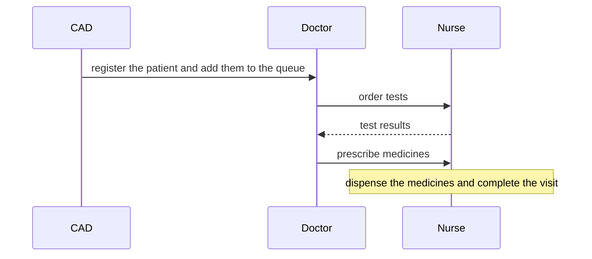

<div align="center" markdown="1">

<h1>Bandhu App</h1>

<a href="https://buildwithhussain.com"></a>

**Patient registration, consultation and dispensing for mobile health clinics**

</div>

Bandhu App runs a mobile clinic visit on Frappe Healthcare: the front desk registers the patient, the doctor
examines them, and the nurse runs tests and hands over medicines. Each role works from its own screen.

### Screens

- **CAD**: register or find a patient, scan a patient card, and add them to the day's queue
- **Doctor**: call the next patient, order tests, prescribe medicines, refer and complete the visit
- **Nurse**: start and end the session, record vitals and test results, and dispense medicines
- **Helpline**: follow up on referred patients and log each call
- **My Schedule**: the sessions a staff member is assigned to, with the site and the team

### Features

- A permanent Clinic ID for each patient, printed on a card with a QR code
- Weekly, fortnightly or monthly session schedules that create the sessions each night
- Boards that update when another role moves a patient on
- Medicine stock tracked by funding source
- Session, clinic, PHI, tests, treatment, referral, patient history and medicine utilisation reports
- A dashboard of today's sessions for managers

### How it works



### Installation

You need ERPNext and [Healthcare](https://github.com/frappe/health), on Frappe 16 or later.

```bash
bench get-app https://github.com/bwhtech/bandhu_custom
bench --site your.site install-app bandhu_app
```

### Development

This app uses `pre-commit` for formatting and linting:

```bash
cd apps/bandhu_app
pre-commit install
```

Run the tests:

```bash
bench --site test_site set-config allow_tests true
bench --site test_site run-tests --app bandhu_app
```

### Support

Found a bug or have a question? [Open an issue](https://github.com/bwhtech/bandhu_custom/issues).

## About BWH Studios

Bandhu App is developed and maintained by BWH Studios, a tech company based in Jagdalpur, Chhattisgarh,
specializing in Frappe customizations and consulting.

#### License

MIT
