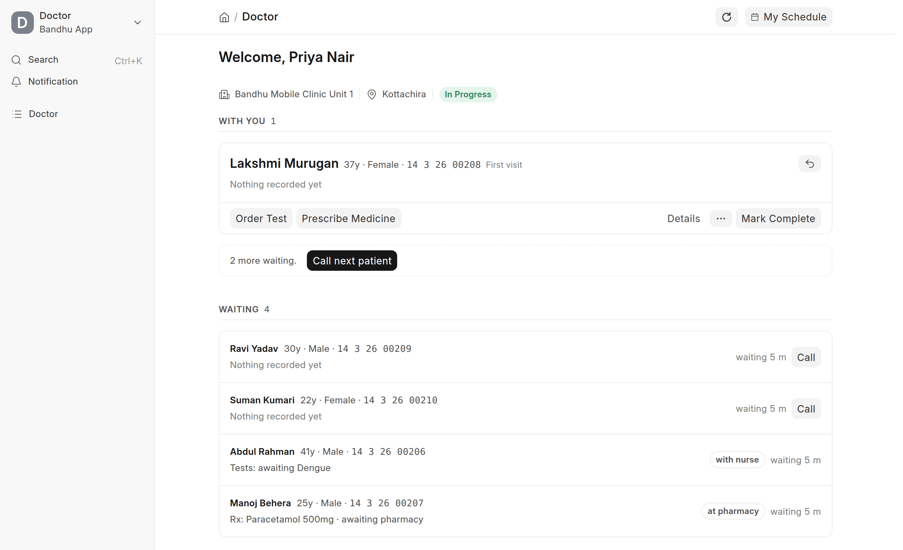
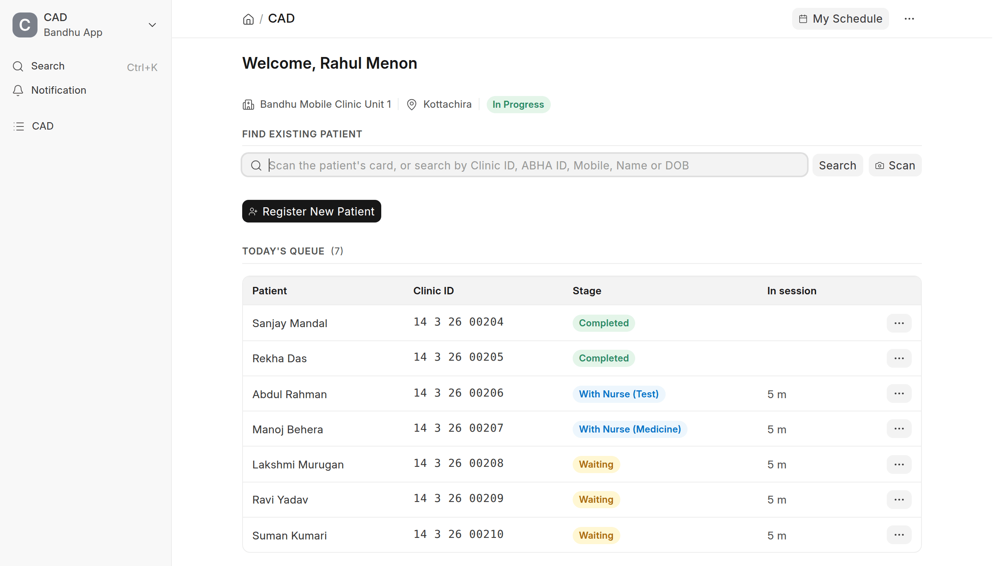
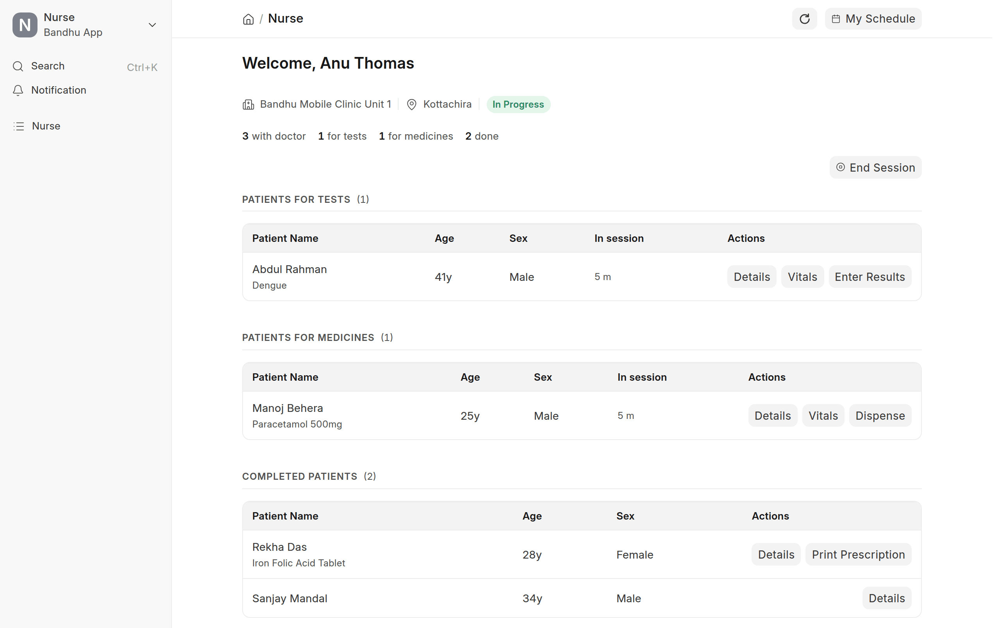
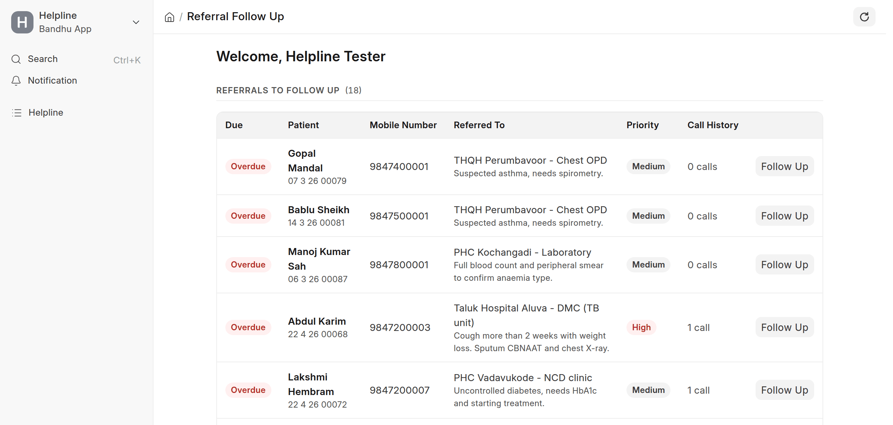
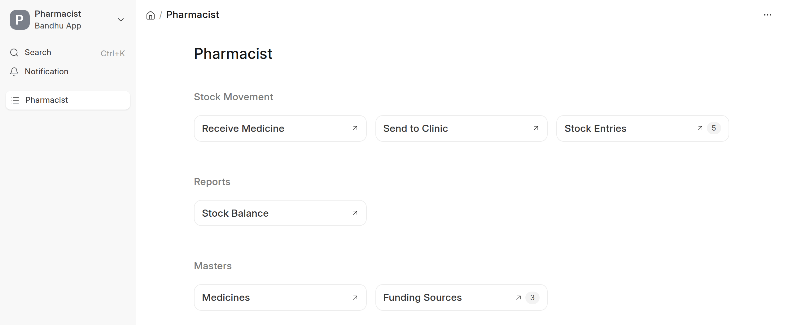
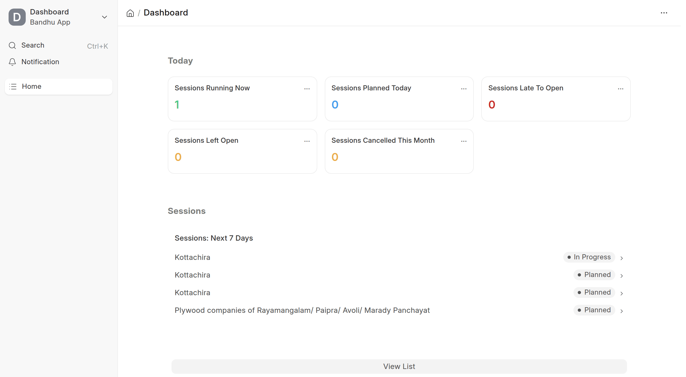
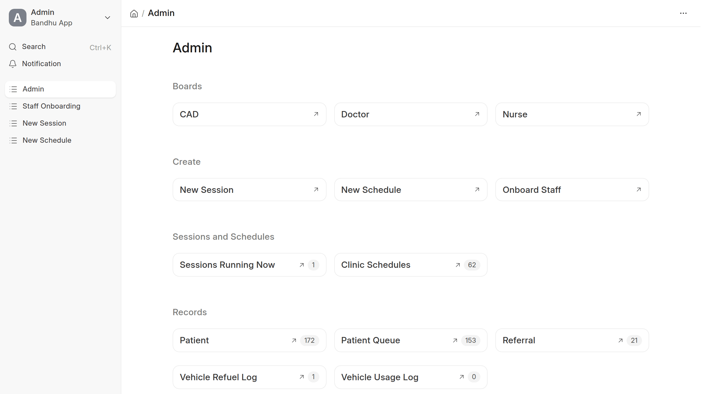
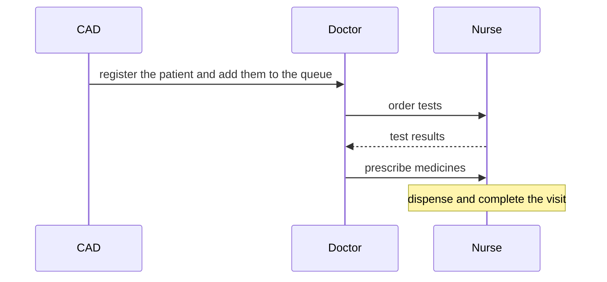

<div align="center" markdown="1">


<h1>Bandhu App</h1>

**Patient registration, consultation and dispensing for mobile health clinics**

<a href="https://buildwithhussain.com"></a>

<div>
	
</div>

</div>

Bandhu App runs a mobile clinic visit on Frappe Healthcare: the front desk registers the patient, the doctor
examines them, and the nurse runs tests and hands over medicines. Each role works from its own screen, and
every screen updates when another role moves a patient on.

### Front desk

The CAD screen finds a patient by Clinic ID, mobile number, name or a scan of their card, registers new
patients, and adds them to the day's queue.

<div>
	
</div>

### Doctor

- Call the next patient from the waiting list
- Order tests, prescribe medicines, refer to a hospital and complete the visit
- See what the nurse is still doing for each patient

### Nurse

- Start and end the clinic session
- Record vitals and test results
- Dispense medicines and print the prescription

<div>
	
</div>

### Helpline

Helpline staff follow up on referred patients, log each call and see which follow-ups are overdue.

<div>
	
</div>

### Pharmacy

Receive medicine, send it to a clinic, and record the funding source on each stock entry.

<div>
	
</div>

### Dashboard and reports

Managers see today's sessions at a glance: running, planned, late to open and left open. Reports cover
sessions, clinics, PHI, tests, treatment, referrals, patient history and medicine utilisation.

<div>
	
</div>

### Admin

Onboard staff, create sessions and recurring schedules, and keep the projects, units and sites up to date.

<div>
	
</div>

### Features

- A permanent Clinic ID for each patient, printed on a card with a QR code
- Weekly, fortnightly or monthly session schedules that create the sessions each night
- A My Schedule page that shows each staff member the sessions they are assigned to
- Medicine stock tracked by funding source

### How it works



### Installation

You need ERPNext and [Healthcare](https://github.com/frappe/health), on Frappe 16 or later.

```bash
bench get-app https://github.com/bwhtech/bandhu_custom
bench --site your.site install-app bandhu_app
```

### Development

This app uses `pre-commit` for formatting and linting:

```bash
cd apps/bandhu_app
pre-commit install
```

Run the tests:

```bash
bench --site test_site set-config allow_tests true
bench --site test_site run-tests --app bandhu_app
```

### Support

Found a bug or have a question? [Open an issue](https://github.com/bwhtech/bandhu_custom/issues).

## About BWH Studios

Bandhu App is developed and maintained by BWH Studios, a tech company based in Jagdalpur, Chhattisgarh,
specializing in Frappe customizations and consulting.

#### License

MIT
